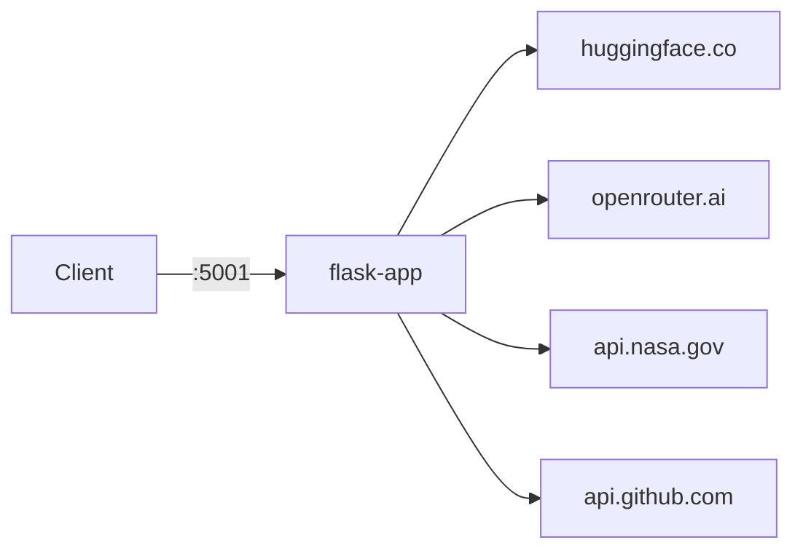
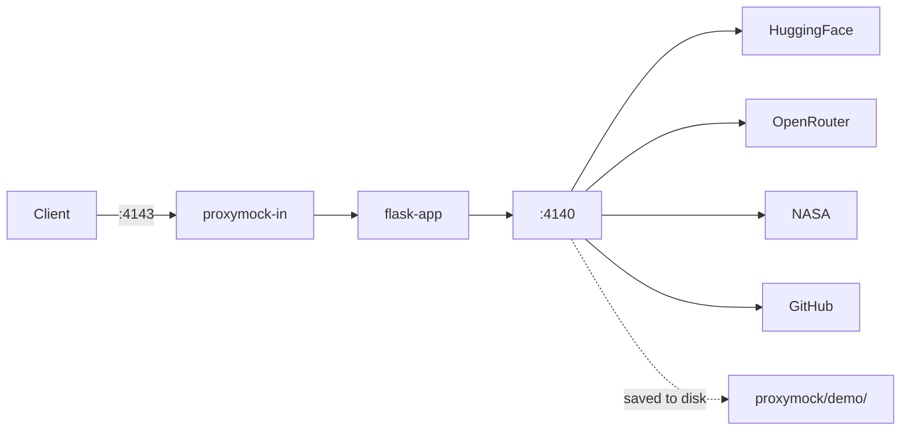
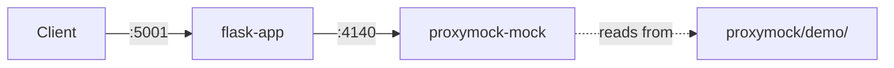

# python-server

Flask app that calls external APIs — useful for demonstrating proxymock record, mock, and replay.

## Endpoints

- `GET /healthz` — health check
- `GET /catalog` — five model IDs from Hugging Face and five from OpenRouter, fetched in one incoming request
- `GET /models` — top downloaded models from [Hugging Face](https://huggingface.co)
- `GET /models/<org>/<model>` — details for a specific model (e.g. `/models/deepseek-ai/DeepSeek-R1`)
- `GET /llm/models` — LLM model catalog and pricing from [OpenRouter](https://openrouter.ai)
- `GET /nasa` — NASA astronomy picture of the day
- `GET /events` — recent GitHub events for the Speedscale org

## Architecture



## Quick start

```bash
make install
make local
# Running on http://0.0.0.0:5001

./test-all.sh
```

## proxymock workflow

### Record

Capture all outbound API calls while using the app:



```bash
make capture
# hit endpoints in another terminal
./test-all.sh localhost:4143
# ctrl-c to stop
```

### Mock

Run the app with recorded responses instead of real APIs:



```bash
make mock

./test-all.sh              # served from recorded data, no real API calls
```

### Replay

Turn recorded traffic into a load test:

```bash
make local &
make replay

# concurrent users
proxymock replay --in proxymock/demo --test-against http://localhost:5001 --vus 10

# CI gate
proxymock replay --in proxymock/demo --test-against http://localhost:5001 \
  --fail-if "requests.failed!=0"
```

## Combined catalog demo

`GET /catalog` calls Hugging Face's model catalog and OpenRouter's model catalog, then returns up to five model IDs from each under `huggingface` and `openrouter`. It does not invoke model inference. If either HTTP dependency fails, the endpoint returns HTTP 500 with an `error` field, like the existing API endpoints.

One successful call through proxymock's recording port captures three request-response pairs: the incoming Flask exchange and one outgoing exchange with each provider. Each pair includes both its request and response. The dependency responses are captured in full even though `/catalog` returns a compact selection of IDs.

After capture, start the same app under `proxymock mock --no-passthrough`. Its outgoing calls are matched and answered from the captured exchanges. Replay the saved incoming request against the app to compare the observed status and body with the recorded result.

Run the focused tests without contacting either provider:

```sh
.venv/bin/python -m unittest discover -s . -p 'test_*.py'
```
