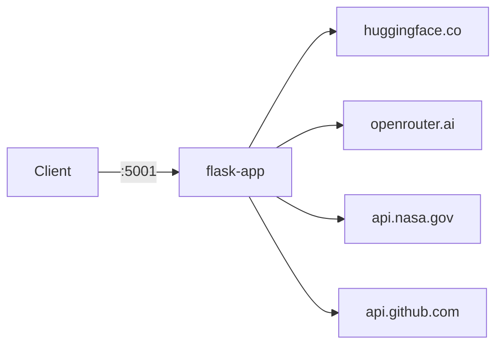
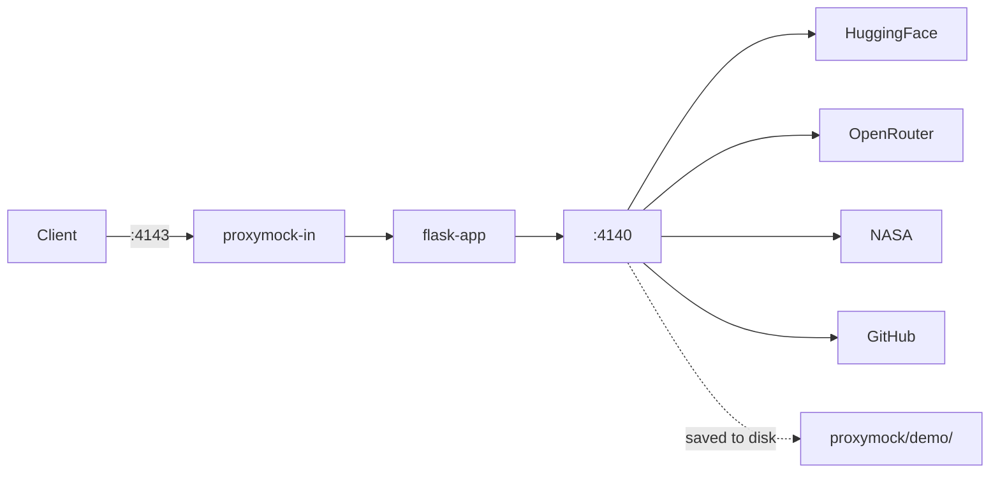
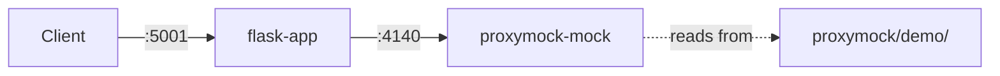

# python-server

Flask app that calls external APIs — useful for demonstrating proxymock record, mock, and replay.

## Endpoints

- `GET /healthz` — health check
- `GET /catalog` — five model IDs from Hugging Face and five from OpenRouter, fetched in one incoming request
- `GET /models` — top downloaded models from [Hugging Face](https://huggingface.co)
- `GET /models/<org>/<model>` — details for a specific model (e.g. `/models/deepseek-ai/DeepSeek-R1`)
- `GET /llm/models` — LLM model catalog and pricing from [OpenRouter](https://openrouter.ai)
- `GET /nasa` — NASA astronomy picture of the day
- `GET /events` — recent GitHub events for the Speedscale org
- `POST /tickets` — support-inbox webhook; parses the raw `From` header with `email.utils.parseaddr` and returns the parsed sender, routing queue and whether an auto-reply goes out

## Architecture



## Quick start

```bash
make install
make local
# Running on http://0.0.0.0:5001

./test-all.sh
```

## proxymock workflow

### Record

Capture all outbound API calls while using the app:



```bash
make capture
# hit endpoints in another terminal
./test-all.sh localhost:4143
# ctrl-c to stop
```

### Mock

Run the app with recorded responses instead of real APIs:



```bash
make mock

./test-all.sh              # served from recorded data, no real API calls
```

### Replay

Turn recorded traffic into a load test:

```bash
make local &
make replay

# concurrent users
proxymock replay --in proxymock/demo --test-against http://localhost:5001 --vus 10

# CI gate
proxymock replay --in proxymock/demo --test-against http://localhost:5001 \
  --fail-if "requests.failed!=0"
```

## Combined catalog demo

`GET /catalog` calls Hugging Face's model catalog and OpenRouter's model catalog, then returns up to five model IDs from each under `huggingface` and `openrouter`. It does not invoke model inference. If either HTTP dependency fails, the endpoint returns HTTP 500 with an `error` field, like the existing API endpoints.

One successful call through proxymock's recording port captures three request-response pairs: the incoming Flask exchange and one outgoing exchange with each provider. Each pair includes both its request and response. The dependency responses are captured in full even though `/catalog` returns a compact selection of IDs.

After capture, start the same app under `proxymock mock --no-passthrough`. Its outgoing calls are matched and answered from the captured exchanges. Replay the saved incoming request against the app to compare the observed status and body with the recorded result.

Run the focused tests without contacting either provider:

```sh
.venv/bin/python -m unittest discover -s . -p 'test_*.py'
```

## Security fast lane demo

A base-image patch should not change what the service returns. This demo shows a patch that does.

The image is pinned to `python:3.12.5-slim`. Python 3.12.6 fixes CVE-2023-27043 by making `email.utils.parseaddr` stricter. After the bump, four of the 11 recorded tickets get a different JSON response while the status stays 201. Two senders that used to be routed with an auto-reply (`alice@example.org, bob@example.org` and `ops@[192.0.2.10]`) land in `needs-review` with no auto-reply. Two senders that were already in `needs-review` get a different `sender.email`. The unit tests pass on both versions.

`proxymock/recording/` holds 14 inbound requests and the Hugging Face and OpenRouter calls they made, recorded against the 3.12.5 image with `./traffic.sh`. The traffic is generated for the demo, not captured from production.

Check an image locally (needs Docker, `jq` and proxymock):

```bash
make fast-lane          # the pinned 3.12.5 image: passes
make fast-lane-patched  # the same app on 3.12.6: fails
```

Set `APP_PORT` if something else already uses port 5001 (for example `APP_PORT=5002 make fast-lane`).

The script mocks every outbound call from the recording, starts the image and replays the recorded inbound requests with the `security-patch` test config (`proxymock/testconfigs/security-patch.json`). The test config gates the run: `httpResponseBody` compares every field of each response with the recording, `httpOutput` checks that the outbound calls still match, and the run fails unless 100% of assertions pass. The built-in `regression` config checks only the response schema, so it passes the 3.12.6 image. After the replay, `proxymock files compare -vv` prints the response body lines that changed for each request.

### Readiness grades

proxymock also grades the run A to F per family, the same way a Speedscale Cloud replay is graded. The `readiness` section of the test config decides which families block the release and which only advise:

| Family | Role in `security-patch` | Why |
|---|---|---|
| Regression | Blocks below A | A security patch should not change any response. |
| Mock fidelity | Blocks below A | If the dependencies did not match the recording, the run cannot vouch for the patch. |
| Spec adherence | Blocks below B | Responses must still match `openapi.yaml`. |
| Performance, Security, Data layer | Advise | Reported, but a patch can still ship on them. |
| Resilience | Off | This demo injects no faults. |

Runtime health, Trend and Coverage need data only Speedscale Cloud has (Kubernetes events, earlier graded reports, production call volume), so a local run shows them as n/a.

On 3.12.6 the readiness section reads:

```
 D    Regression      blocks below A    92.86% pass
 A    Performance     advises           p99 30.24 ms
 A    Spec adherence  blocks below B    100% conform
 B    Security        advises           3 open, worst low
 A    Mock fidelity   blocks below A    100% matched
 - Bring Regression from D to A: 92.86% pass now, A at >= 99.5%.
Readiness verdict: NOT READY (... blocking: Regression, Spec adherence, Mock fidelity)
```

Spec adherence stays at A because the changed responses still have the right shape: `valid_sender` is still a boolean and `queue` is still one of the allowed values. Only the field-by-field comparison with the recording catches the change. To make the check more thorough, mark more families as blocking or add chaos rules for Resilience. Each one you add makes the run longer, so match the depth to the kind of patch.

Readiness grades need a proxymock release that includes them. Older releases skip the section, and the test config goals still gate the run.

`.github/workflows/security-fast-lane.yml` runs the same check, after a Trivy scan, on pull requests that change the Dockerfile or requirements. To see it fail, change the base image to `python:3.12.6-slim`.
